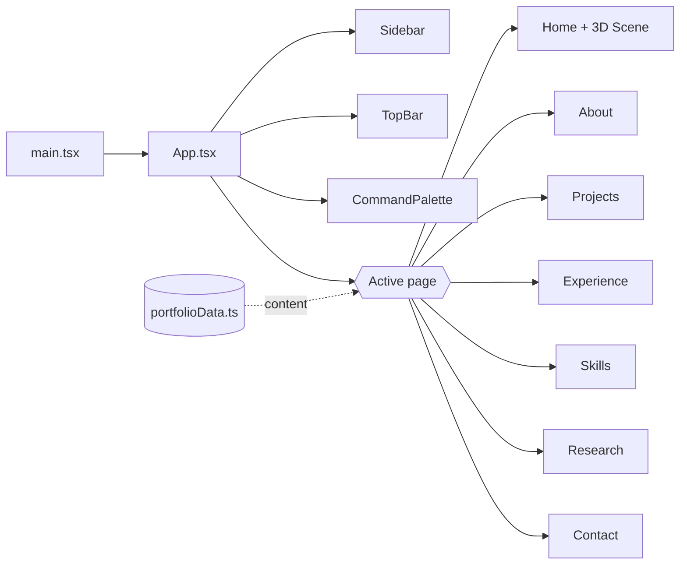

<div align="center">


<br/>

[](https://react.dev)
[](https://www.typescriptlang.org)
[](https://threejs.org)
[](https://vitejs.dev)
[](https://tailwindcss.com)

<br/>

**[🌐 Live Demo](#)** &nbsp;•&nbsp; **[✨ Features](#-features)** &nbsp;•&nbsp; **[🚀 Quick Start](#-quick-start)** &nbsp;•&nbsp; **[🧱 Architecture](#-architecture)** &nbsp;•&nbsp; **[🎨 Customise](#-customise-it)**

<sub>Replace the Live Demo link above with your Netlify URL.</sub>

</div>

---

## 👋 About

A single-page portfolio for a **Biomedical Engineering student and healthcare AI developer**. It mixes an *engineering-dashboard* interface with an **interactive 3D biomedical scene**, a command palette, and smooth motion, and it works on both desktop and mobile.

---

## ✨ Features

| | Feature | Details |
|---|---|---|
| 🧬 | **Interactive 3D scene** | Biomedical visualisation rendered with Three.js |
| 🧭 | **Dashboard layout** | Fixed sidebar and top bar on desktop, slide-in drawer on mobile |
| ⌨️ | **Command palette** | Press <kbd>Ctrl</kbd>/<kbd>⌘</kbd> + <kbd>K</kbd> to search and jump anywhere |
| 🌗 | **Light / dark theme** | Preference is remembered between visits |
| 🎞️ | **Smooth motion** | Scroll-reveal animations, scroll progress bar, desktop cursor glow |
| 💻 | **Terminal-style hero** | Developer-flavoured intro panel |
| ✉️ | **Contact modal** | Quick message flow from anywhere on the site |

### ⌨️ Keyboard shortcuts

| Key | Action | Key | Action |
|:---:|---|:---:|---|
| <kbd>1</kbd> | Home | <kbd>5</kbd> | Skills |
| <kbd>2</kbd> | About | <kbd>6</kbd> | Research |
| <kbd>3</kbd> | Projects | <kbd>7</kbd> | Contact |
| <kbd>4</kbd> | Experience | <kbd>Ctrl/⌘ + K</kbd> | Command palette |

---

## 🧱 Architecture

<div align="center">

</div>



---

## 🛠️ Tech Stack

<div align="center">

| Layer | Tools |
|---|---|
| **Framework** | React 19 · TypeScript |
| **Build tool** | Vite |
| **Styling** | Tailwind CSS v4 · CSS variables for theming |
| **3D graphics** | Three.js |
| **Animation** | Motion · IntersectionObserver |
| **Icons** | Lucide React |

</div>

---

## 🚀 Quick Start

**Prerequisites:** [Node.js](https://nodejs.org/) 20.19+ or 22+ (LTS recommended)

```bash
# 1. Clone
git clone https://github.com/Kishorerm0602/<your-repo-name>.git
cd <your-repo-name>

# 2. Install
npm install
# peer-dependency error? use:  npm install --legacy-peer-deps

# 3. Run
npm run dev
```

Open **http://localhost:3000** 🎉

> 💡 No API keys or `.env` file are needed to run this project.

### 📜 Scripts

| Command | What it does |
|---|---|
| `npm run dev` | Start the dev server on port 3000 |
| `npm run build` | Production build into `dist/` |
| `npm run preview` | Preview the production build locally |
| `npm run lint` | Type-check with `tsc --noEmit` |
| `npm run clean` | Remove `dist/` |

---

## 🎨 Customise It

| I want to change… | Edit this file |
|---|---|
| Name, bio, projects, experience, skills, research | `src/data/portfolioData.ts` |
| Colours (light & dark) | CSS variables at the top of `src/index.css` |
| Page layout and shortcuts | `src/App.tsx` |
| 3D scene | `src/components/3d/BiomedicalScene.tsx` |
| Project images | `src/assets/images/` |

<details>
<summary><b>📁 Project structure</b> (click to expand)</summary>

```
.
├── docs/                       # README banner + architecture art
├── public/                     # Static assets
├── src/
│   ├── assets/images/          # Project images
│   ├── components/
│   │   ├── 3d/                 # Three.js biomedical scene
│   │   ├── about/
│   │   ├── common/             # Shared components (Reveal)
│   │   ├── contact/            # Contact section + email modal
│   │   ├── experience/
│   │   ├── hero/               # Home hero + terminal
│   │   ├── navigation/         # Sidebar, top bar, command palette
│   │   ├── projects/
│   │   ├── research/
│   │   └── skills/
│   ├── data/portfolioData.ts   # All portfolio content
│   ├── hooks/                  # useScrollReveal
│   ├── types/                  # TypeScript types
│   ├── App.tsx                 # Layout, page state, shortcuts
│   ├── index.css               # Theme variables + global styles
│   └── main.tsx                # Entry point
├── index.html
├── vite.config.ts
└── package.json
```

</details>

---

## 🌍 Deployment

This is a static Vite app, so it deploys anywhere.

| Platform | Build command | Output directory |
|---|---|---|
| **Netlify** | `npm run build` | `dist` |
| **Vercel** | `npm run build` | `dist` |
| **GitHub Pages** | `npm run build` | `dist` |

---

## 📬 Connect

<div align="center">

**Kishore R M** — Biomedical Engineer · Healthcare AI Developer

[](https://github.com/Kishorerm0602)
[](https://orcid.org/0009-0007-3212-1068)

<br/>

⭐ If you like this project, consider giving it a star!

<sub>Released under the Apache-2.0 License</sub>

</div>